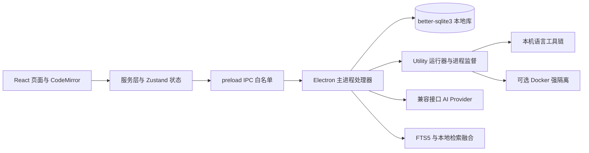

> 历史归档；结论和停止指令仅适用于原报告阶段。当前状态以根目录 PROJECT_STATUS.md 为准。
> 本版仅调整路径、私人标识和归档说明；原字节与冻结路径保留在本机。仅本机证据不随 Git 分发。

# CodeHelper Studio 深度技术分析

核验日期：2026-10-08（Asia/Shanghai）。分析对象为用户指定的 [SuLiverse/CodeHelper-Studio](https://github.com/SuLiverse/CodeHelper-Studio)，固定提交 `23773e843d2a7bc3b04eedff59055b6c3a7afe7b`，包版本 `2.4.2`。本报告为静态源码调研，未安装依赖、启动应用、运行上游测试或修改参考源码。

## 1. 结论与证据边界

**值得作为 Windows 桌面原型和条件性 Fork 对象；不建议立即把整个项目定为正式底座。** 它已包含题库判题、自动错题收集、SM-2 复习、自评、AI 复盘、上下文辅导、本地检索和 Agent 审计。专项作品需要在这些能力之外形成可测试的改进。现阶段最有价值的缺口是：把诊断与真实执行证据连接起来，并用新的题目验证学习迁移。

本地工作目录及其父级检查未发现《AIC_AI开源比赛指导文档_2026 (1).md》。评估采用用户提供的原则，并已核对 [AIC 官方赛题通知](https://www.aicomp.cn/tracks/tracks-5/4924.html)及附件。官网初赛提交截止为 **2026-10-15 20:00**，当前只剩约一周；以下 2～4 周估算不能直接当作本届初赛剩余时间。

使用三类标记：

- **源码已验证**：取得固定提交的文件并检查相关执行路径，表示代码存在，不表示本机运行通过。
- **文档声称**：README、发布说明中的描述，未获得独立运行证据。
- **待验证／推断**：根据结构提出的风险、缺口或改进假设，不能当成已证实效果。

搜索索引混入了旧 `SuLiverse/CodeHelper` 页面，提到 Monaco 和仓库迁移；本次 API 返回的仓库名为 `SuLiverse/CodeHelper-Studio`，`TIANWEN-cpu/CodeHelper-Studio` API 返回重定向，README 和 package 的仓库链接仍使用后者。**未把旧页面的功能或 Star 数用于本次结论。** 当前取得的 package 和编辑器源码使用 CodeMirror。下一轮应确认上游规范地址，但本报告的文件链接固定到已取得的提交。

## 2. 维护、发布和工程基础

| 项目 | 实际取得的信息 | 判断 |
|---|---|---|
| Star | API 为 0，核验于 2026-10-08 | 与部分搜索索引不同；低 Star 不等于不可用，也不能当作社区成熟度证明 |
| 默认分支最新提交 | 2026-08-01T20:58:08Z，`23773e8` | 截至核验约两个月无默认分支新提交；`pushed_at` 不等同于最新代码提交 |
| Release | `v2.4.2`，2026-08-01T20:39:37Z | 发布记录存在；有 Windows 安装版、Portable、清单及哈希资产 |
| 发布体积 | Portable 135,248,688 字节；Installer 135,671,868 字节 | 约 135 MB 下载量，不是轻量网页模块 |
| 测试结构 | 固定树中匹配 `tests/**/*.test.ts(x)` 的文件 151 个，并有 Electron E2E | 文件数不是测试用例数、覆盖率或通过数 |
| 已读测试 | `reviewSm2.test.ts`、`problemsIpc.test.ts`、`agentWorkflow.test.ts`、检索评估与 runner IPC 测试等 | 能确认测试意图；未执行，不能据此宣称稳定或学习效果有效 |

可复查：[仓库 API](https://api.github.com/repos/SuLiverse/CodeHelper-Studio)、[固定提交](https://github.com/SuLiverse/CodeHelper-Studio/commit/23773e843d2a7bc3b04eedff59055b6c3a7afe7b)、[Release](https://github.com/SuLiverse/CodeHelper-Studio/releases/tag/v2.4.2)。

README 声称审计、类型检查、lint、测试和构建通过；本轮没有复现这些检查。也没有核验 EXE 的行为、签名或发布资产与源码是否完全一致。

## 3. 架构与核心模块

| 层次 | 实际结构 | 专项应用价值 |
|---|---|---|
| 桌面与构建 | Electron `^41.10.3`、electron-vite `^5.0.0`、electron-builder；主进程 `electron/main.ts` | 本地文件、窗口、安装包基础可复用；原生模块 ABI 与打包成本要计入 |
| 前端 | React `^19.2.4`、TypeScript `^6.0.2`、Zustand、Tailwind、motion | 页面、状态、服务分层可参考；版本需随 lockfile 固定 |
| 编辑器 | `@uiw/react-codemirror` 与 Python/C++/JS/SQL language 包 | 值得保留；不是旧宣传中的 Monaco |
| 数据 | `better-sqlite3 ^12.8.0`、schema、迁移、备份恢复 | 本地错题和提交历史很合适；不要复制完整 schema 后随意删表 |
| IPC | `electron/preload.ts` 中 invoke 白名单；服务层负责调用 | 保留边界设计；独立项目需重新定义少量事件，不必移植全部频道 |
| AI | `electron/ipc/ai.ts`、Provider URL 校验、流式请求、取消、记忆与 RAG 注入 | 兼容接口适配有价值；并非已确认支持每家原生 API 协议 |
| 运行 | `codeRunner.ts`、Supervisor、Utility、Windows Job Host 相关实现；可选 Docker | Windows 工程处理较多，抽取成本明显高于复制一个函数 |
| 学习 | problems、mistakes、review、learningRecords、课程与成就 | 保留专项闭环；课程和成就不必成为首版功能 |

依据：[package.json][CH-PKG]、[CodeEditor][CH-EDITOR]、[主进程][CH-MAIN]、[preload][CH-PRELOAD]、[数据库 schema][CH-SCHEMA]。

## 4. 已有功能：按执行路径确认

| 功能 | 状态与代码证据 | 重要边界 |
|---|---|---|
| 代码编辑与多语言支持 | 源码已验证：CodeEditor、语言扩展；runner 按 Python/C/C++/C#/JS/SQL 分派 | 工具链需本机具备，不能把语言菜单当成所有语言已可运行 |
| 逐用例判题 | 源码已验证：`electron/ipc/problems.ts:140–190` | 普通语言执行并比较规范化 stdout；遇到首个错误会提前停止，不是全部用例诊断 |
| 提交历史 | 源码已验证：同文件 `195–208`，`submissions` 表 | 记录代码、状态、通过数和耗时；该表不保存逐用例输入、实际输出、stderr 或 trace |
| 自动错题收集 | 源码已验证：同文件 `210–241`；按 problem_id 合并错误次数、状态类型、最后错误代码，并保存正确代码 | 错误类型是 WA／编译／运行／超时等执行类别，不是学习者误解分类 |
| 失败后进入复习 | 源码已验证：同文件 `229–236`，插入 `review_schedule` | 已有排程通过 `INSERT OR IGNORE` 保留；本路径没有因新失败自动重置已有间隔 |
| 错题管理 | 源码已验证：`mistakes.ts:34–92` 列表、详情、分析保存、删除 | 删除会事务性清除对应排程；不应再把“自动收集＋管理”称为创新 |
| SM-2 | 源码已验证：`review.ts:63–97`，到期查询、更新、统计 | 已有算法与日期回归测试，不应宣称原项目没有间隔复习 |
| 用户自评 | 源码已验证：`ReviewView.tsx:222–248`；按钮对应 quality 2／3／5 | 用户可在未重新提交代码时评价自己；自评不是客观掌握验收 |
| AI 错题复盘 | 源码已验证：`ReviewView.tsx:255–286`，`quickAsk` 后持久化 | 主要为自由文本模型生成；失败回退本地规则，并标注 |
| 无 AI 时的规则建议 | 源码已验证：同文件 `191–217`，检查 range、return、dict、while、sort 等文本 | 是通用检查提示，不是经验证的错因诊断 |
| 上下文 AI 辅导 | 源码已验证：AITutorPanel 有多种辅导模式与快捷提示，AI IPC 注入记忆／RAG | 已有“不剧透提示”“同类训练题”“最小反例”等提示词入口，不等于生成题已被执行验证 |
| 本地知识检索 | 源码已验证：FTS5 BM25、trigram、术语扩展、字符 n-gram、RRF 融合及降级 | 已超过简单字符串检索；这里的“语义”是本地近似，不是已确认的训练式 embedding 模型 |
| Agent 工具与审计 | 源码已验证：agent IPC、工具执行、审批、运行记录；白名单核心为知识检索和强隔离运行 | 有真实工具执行和结果记录；四步进度不等于模型自主规划的通用 Agent 循环 |
| 学习活动与统计 | 源码已验证：analytics IPC、learningRecords IPC、对应表 | 能记录活动和汇总，不足以单独证明学习提升 |

依据：[判题与收集][CH-PROBLEMS]、[错题管理][CH-MISTAKES]、[复习调度][CH-REVIEW]、[复盘界面][CH-REVIEW-UI]、[AI 侧栏][CH-TUTOR]、[检索仓储][CH-RETRIEVAL-DB]、[检索算法][CH-RETRIEVAL]、[Agent IPC][CH-AGENT]。

## 5. 文档主张、部分实现和明显局限

### 5.1 AI 复盘确实存在，但诊断证据不足

`buildMistakePrompt` 的注释称“题面＋错误类型＋知识点＋错误代码”，实际数组只加入**题目标题、执行错误类别、题目 tags、最后错误代码、可选正确代码**；没有加入完整 description、真实失败输入、期望／实际输出、stderr 或多次提交的差异。`quickAsk` 的通用记忆注入可能增加上下文，但不能据此宣称这些执行证据必然进入复盘。

因此可以确认“会给错题分析”，不能确认“能可靠区分题意理解、边界判断、状态更新或概念误解”。模型看到代码并不能直接知道学习者为什么这样写，需要一次有针对性的追问或独立诊断题补充证据。[复盘构造位置][CH-REVIEW-UI]

### 5.2 没发现经验证的跨题错因模型

已检查的 schema 与核心路径中，错题以题目为单位保存 `ai_analysis` 文本和执行错误类别；未见独立的“误解假设—证据—学习者回答—多题关联—置信度校准”数据结构。知识库标签和通用 `memories` 并不自动构成知识漏洞模型。

这是**基于已检查范围的缺口判断**，不是对全仓库每一行的否定。未来应以 20～30 个同概念、不同故障表现的案例，检验跨题聚合能否成立，而不是直接上知识图谱。[schema][CH-SCHEMA]

### 5.3 复习闭环存在，掌握验收偏弱

`review-stats` 将 `repetitions >= 3` 的排程计为 mastered（`review.ts:228–232`）。连续三次成功评价能增加次数，但用户评价由自评按钮提交。**“三次自评通过”不是“能独立解决新题”。** 同时，失败提交对已有 schedule 不重置：这是现有策略行为，尚未运行验证其实际学习影响。[复习实现][CH-REVIEW]

`mistakes` 中还有 `review_count`、`next_review_at`，实际已读核心排程路径主要使用 `review_schedule`；精简或数据迁移前需核查全部读写者，不能仅按字段名删除“重复字段”。

### 5.4 SQL 运行和 SQL 判题是两条路径

通用 runner 的 SQL 能在内存 SQLite 中执行；但 `problems-submit` 的 SQL 分支（`152–166`）比较 `normalizeSql(code)` 与规范化 expected SQL 文本。**当前题库提交不是结果集等价判定**，等价 SQL 可能被判错。这是源码可确认的局限，适合专门做 SQLite 结果判题改进，不能把它描述为已具备完整 SQL OJ。[判题分支][CH-PROBLEMS]

### 5.5 运行器有保护，但不应混淆隔离级别

代码含默认运行 10 秒、编译 15 秒、输出 1 MB、最大并发 5，以及监督与清理逻辑。强隔离走 Docker，配置包括禁网络、只读、cap-drop、进程和内存限制；本机受控运行仍调用宿主工具链。**不能因为有 timeout 就把本机执行称为可安全接收任意陌生代码的服务。** 这些保护本轮未进行攻击测试或 Windows 兼容测试。[运行器][CH-RUNNER]、[Docker runner][CH-DOCKER]

### 5.6 Agent 的能力边界

`agent.ts` 按已创建的 toolCalls 执行并记录审批、取消、结果；`agentWorkflow.ts:61–68` 根据运行状态绘制四步状态，`105–139` 将工具证据组成模型报告提示。可保留工具结果审计，但不能把“理解／计划／执行／复盘”标签视为已证明模型进行多轮自主计划、诊断学习者或验证教学效果。[工作流][CH-WORKFLOW]

### 5.7 测试不足以支撑教育效果主张

SM-2 测试检查公式、成功／失败更新、UTC 日期；判题测试包含 SQL 文本比较、执行状态和输入验证；检索测试检查检索效果。它们是工程测试，不是学习实验。未取得诊断标注集、一致性评估、未见变式题表现或延迟复测的独立结果。

## 6. 哪些保留，哪些可精简

| 模块 | 建议 | 原因与迁移代价 |
|---|---|---|
| Electron shell、preload 安全边界 | 桌面路线保留 | 本地数据和 Windows 分发有价值；独立网页路线不必移植 |
| CodeMirror、少量状态和服务层 | 优先保留／参考 | 与专项编辑、提交直接相关；避免连带搬运所有视图状态 |
| SQLite、迁移、备份 | 优先保留 | 用户错题不可轻易丢失；需要保留数据一致性设计 |
| problems／submissions／mistakes | 保留并扩充证据结构 | 新增逐用例结果、诊断假设、迁移题结果，避免只保存最后一段分析 |
| AI Provider、请求取消、Key 存储 | 保留 | `apiKeyStorage.ts` 使用 Electron safeStorage；不足时拒绝存储，不应自行改成明文兜底 |
| SM-2 | 第一版保留作为基线 | 先改观测和验收，不急于换算法；接入 FSRS 后也需真实日志与独立题 |
| 本地检索 | 有明确资料库时保留 | 十来个概念可先用显式映射；无需为了“RAG”引入整个知识维护系统 |
| 本机多语言 runner | 有 C/C++ 需求才优先保留 | 依赖监督、平台进程管理、工具链检测，不宜直接摘单文件 |
| Docker 强隔离和 Agent | 首版可不启用，保留能力边界 | Python 单用户可信案例可采用较小路线；未经验证不要移除保护再宣称安全 |
| 全量课程、成就、宠物、通用工作区 | 专项首版优先隐藏，后续审慎删除 | 与核心训练无关；移除会影响 appStore、路由、快捷键、IPC、数据和退出恢复 |
| 全量题库／资源包／外部平台链接 | 优先替换为小型可授权题集 | 比功能精简更重要的是题目来源和判题覆盖 |
| 知识维护、链接审计、Profile 复杂统计 | 延后 | 有价值，但不是首个诊断闭环所必需 |

**隐藏页面**只减少入口，保留构建、依赖和数据；**删除功能**还需取消组件导入、服务调用、IPC 频道、事件和回归检查；**彻底解除依赖**还需清理 package／lockfile、构建配置、资源与迁移约束。三者成本不同。首轮原型以隐藏为主；确认路线后再按依赖关系删除。

具体耦合证据：App 有九类主视图、全局 AI 侧栏与宠物；main 集中注册多组 IPC；preload 有统一频道白名单；练习视图依赖工作区 tab、草稿保存、退出 flush。删除课程页面不代表能立刻移除课程 schema，删除工作区也可能破坏练习编辑器恢复。[App][CH-APP]、[main][CH-MAIN]、[preload][CH-PRELOAD]

## 7. 许可证与贡献边界

根目录 LICENSE 已读取，为 **MIT**：可以修改和分发，须保留适用的版权与许可文本。Fork 时建议保留原 LICENSE，另列自主修改说明、来源版本、第三方资源清单；作品名称、图标、题目、数据、依赖和模型服务不能仅凭根 MIT 一并判断可重新授权。[LICENSE][CH-LICENSE]

已读 `resources/problems/leetcode.json` 的第一项为“两数之和”，包含中文题面、样例、starter 与 hints；抽样未见逐题授权字段。**这不证明侵权，但说明根代码许可证不足以独立证明外部题面再分发授权。** 全量题库还包括多种外部平台命名的资源。参赛版更稳妥的是自拟小题、经过来源核验的 MIT 练习，或仅保存外部链接，不直接搬运所有题面。[题库抽样][CH-LEETCODE]

Coding Agent 生成的修改也须由参赛者审核、验证并披露工具用途；不能将原作者 runner、SM-2 或检索实现列为自主算法。自主成果可集中在诊断证据协议、误解案例集、有效变式验证、独立掌握验收和评测工具。

## 8. 如果 Fork，最值得改造什么

以下为机会和工时推断，按单人＋Coding Agent、已有工具链估算，包含基本工程测试，不含可靠长期学习实验。不是实际开发承诺。

| 改造方向 | 与原项目的具体差别 | 最小验收方法 | 预计额外工作 |
|---|---|---|---|
| 失败证据驱动的复盘 | 原入口以标题和代码生成文本；新增真实失败输入／输出／stderr、完整题面及诊断证据 ID，允许输出“证据不足” | 固定 30～50 个带专家错因的案例；与原 quickAsk 同模型对比错因正确率、无证据断言率和重跑一致性 | 4～7 天；若重构 runner 可更长 |
| 同错因跨题验证 | 原按题目收集和复习；新增小型误解 taxonomy、追问确认、跨题关联与新的验证任务 | 相同表面错误不同原因、不同表面错误相同原因；报告分类混淆与未见题一次通过率 | 7～12 天；标注数据是主要成本 |
| 独立掌握门槛 | 原自评与 repetitions 驱动；新增辅助后、无辅助、新题三类状态，保留所有失败观测 | 比较“自评已掌握但独立题失败”的比例；记录提示次数与延迟复测，禁止合并统计 | 4～7 天；7 天内只能验证短期结果 |
| SQLite 结果集判题 | 原 SQL 提交比较文本；在受控固定数据库上比较结果并说明行序、重复、NULL、数值规则 | 等价 SQL／有序与无序／NULL／重复行／错误结果的人工测试集，和原文本判题对比 | 4～6 天；只做 SELECT 可控子集 |

三类一般功能不能再声称原创：自动收集＋AI 复盘、SM-2／FSRS 调度、AI 辅导／RAG／Agent 工具。CodeHelper 的快捷提示已有生成同类题和反例，外部 OpenTutor 也已有结构化错因与派生诊断题。因此即使补上 JSON 结构，也需要**真实执行约束、诊断证据校验或新题验收**，而非只改变输出格式。

## 9. Fork 决策条件

建议后续获得开发授权后，用最多 1～2 天验证四件事：固定提交能在目标 Windows 启动；一份正确／错误代码确实贯通提交与错题；新增诊断入口可独立落表；基础数据能备份恢复。若基线安装、ABI 或打包已经消耗两天，或专项改动必须同时修改多个全局状态和大量 IPC，转向独立轻项目更符合时间约束。

对当前仅剩一周的初赛，**先隐藏非核心模块并新增一个可验证能力**的风险低于全面精简。是否 Fork 仍取决于后续实际运行检查；本轮没有替用户决定，也未创建 Fork。

## 10. 尚未确认

目标 Windows 的 Node／编译器／Docker 条件、锁定版本的实际安装和构建、真实 Provider 兼容性、EXE 与提交的一致性、完整题库和素材权利、所有学习记录的完整保留、未检查路径是否存在更强诊断，以及任何学习增益均尚未确认。错误诊断不能从程序错误直接推定人的知识漏洞。

[CH-PKG]: https://github.com/SuLiverse/CodeHelper-Studio/blob/23773e843d2a7bc3b04eedff59055b6c3a7afe7b/package.json
[CH-EDITOR]: https://github.com/SuLiverse/CodeHelper-Studio/blob/23773e843d2a7bc3b04eedff59055b6c3a7afe7b/src/components/editor/CodeEditor.tsx
[CH-MAIN]: https://github.com/SuLiverse/CodeHelper-Studio/blob/23773e843d2a7bc3b04eedff59055b6c3a7afe7b/electron/main.ts
[CH-PRELOAD]: https://github.com/SuLiverse/CodeHelper-Studio/blob/23773e843d2a7bc3b04eedff59055b6c3a7afe7b/electron/preload.ts
[CH-SCHEMA]: https://github.com/SuLiverse/CodeHelper-Studio/blob/23773e843d2a7bc3b04eedff59055b6c3a7afe7b/electron/db/schema.sql
[CH-PROBLEMS]: https://github.com/SuLiverse/CodeHelper-Studio/blob/23773e843d2a7bc3b04eedff59055b6c3a7afe7b/electron/ipc/problems.ts#L140-L244
[CH-MISTAKES]: https://github.com/SuLiverse/CodeHelper-Studio/blob/23773e843d2a7bc3b04eedff59055b6c3a7afe7b/electron/ipc/mistakes.ts
[CH-REVIEW]: https://github.com/SuLiverse/CodeHelper-Studio/blob/23773e843d2a7bc3b04eedff59055b6c3a7afe7b/electron/ipc/review.ts
[CH-REVIEW-UI]: https://github.com/SuLiverse/CodeHelper-Studio/blob/23773e843d2a7bc3b04eedff59055b6c3a7afe7b/src/views/ReviewView.tsx#L191-L286
[CH-TUTOR]: https://github.com/SuLiverse/CodeHelper-Studio/blob/23773e843d2a7bc3b04eedff59055b6c3a7afe7b/src/components/layout/AITutorPanel.tsx#L59-L246
[CH-RETRIEVAL-DB]: https://github.com/SuLiverse/CodeHelper-Studio/blob/23773e843d2a7bc3b04eedff59055b6c3a7afe7b/electron/db/knowledgeRetrievalRepository.ts
[CH-RETRIEVAL]: https://github.com/SuLiverse/CodeHelper-Studio/blob/23773e843d2a7bc3b04eedff59055b6c3a7afe7b/electron/utils/knowledgeRetrieval.ts
[CH-AGENT]: https://github.com/SuLiverse/CodeHelper-Studio/blob/23773e843d2a7bc3b04eedff59055b6c3a7afe7b/electron/ipc/agent.ts
[CH-WORKFLOW]: https://github.com/SuLiverse/CodeHelper-Studio/blob/23773e843d2a7bc3b04eedff59055b6c3a7afe7b/src/utils/agentWorkflow.ts
[CH-RUNNER]: https://github.com/SuLiverse/CodeHelper-Studio/blob/23773e843d2a7bc3b04eedff59055b6c3a7afe7b/electron/utils/codeRunner.ts
[CH-DOCKER]: https://github.com/SuLiverse/CodeHelper-Studio/blob/23773e843d2a7bc3b04eedff59055b6c3a7afe7b/electron/utils/dockerRunner.ts
[CH-APP]: https://github.com/SuLiverse/CodeHelper-Studio/blob/23773e843d2a7bc3b04eedff59055b6c3a7afe7b/src/App.tsx
[CH-LICENSE]: https://github.com/SuLiverse/CodeHelper-Studio/blob/23773e843d2a7bc3b04eedff59055b6c3a7afe7b/LICENSE
[CH-LEETCODE]: https://github.com/SuLiverse/CodeHelper-Studio/blob/23773e843d2a7bc3b04eedff59055b6c3a7afe7b/resources/problems/leetcode.json
