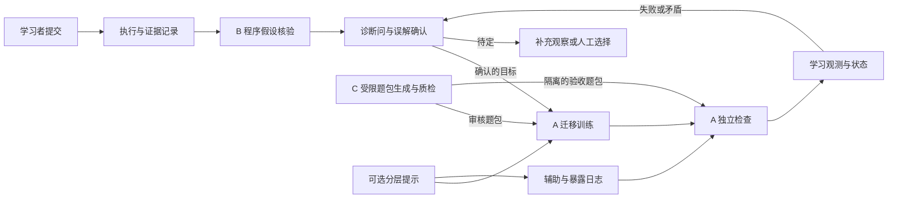
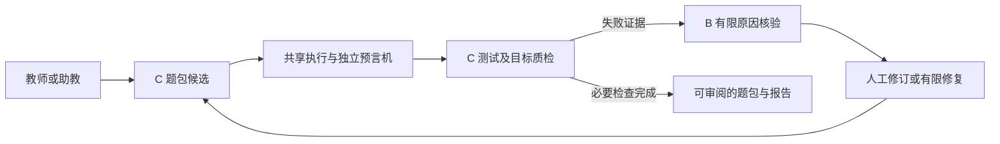
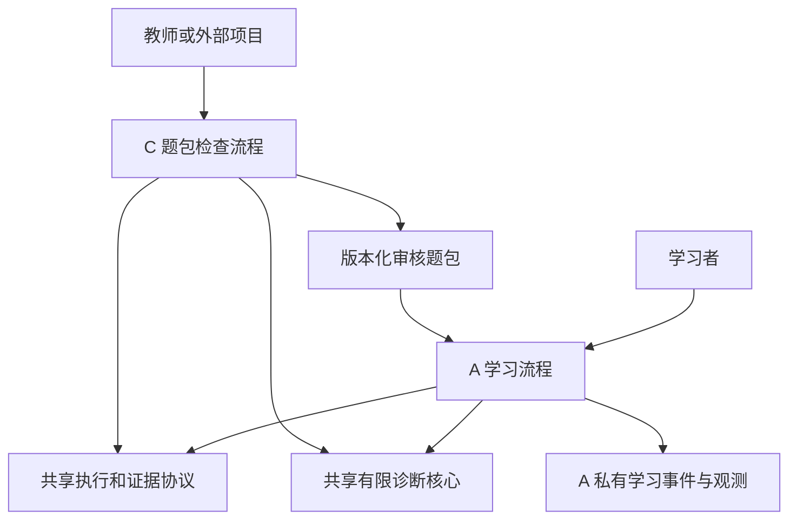
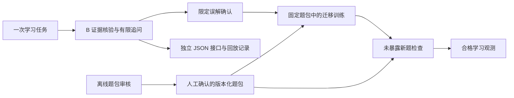

> 历史归档；结论和停止指令仅适用于原报告阶段。当前状态以根目录 PROJECT_STATUS.md 为准。
> 本版仅调整路径、私人标识和归档说明；原字节与冻结路径保留在本机。仅本机证据不随 Git 分发。

# 产品结构比较、复用边界与候选评分

日期：2026-10-08。架构图、接口与评分均为设计判断，未实现、部署或实测。评分使用用户指定的本轮量表，不是 AIC 官方评分或获奖预测；截止时间不参与评价。源码依据见[重叠审查](<innovation_overlap_audit.md>)，技术与案例见[可行性审查](<abc_feasibility_validation.md>)。

## 1. 结构 I：A 为主，B 为核心，C 为有限辅助

目标用户是 Python 入门学习者。主线是“这次为何错、是否存在知识漏洞、怎样训练、能否自己做新题”，不是通用课程平台。B 只提供诊断与追问核心，不能在 A 之外另做一个重复诊断工作台；C 限于同目标题包生成／检查，不做完整教师平台。

**共享数据流：** `ProblemSpec → ExecutionEvidence → ProgramHypothesis → GapHypothesis → TrainingTask → LearningObservation`；提示与题族暴露是独立检查的资格输入。训练题包与验收题包在用途与暴露记录上分区；验收期间不输出目标题的提示。C 草稿不直接推送给学习者。

**最大自主价值候选：** 从“原因是否受证据支持”到“独立观测是否合格”的状态传播规则。普通用例、生成题、FSRS 和页面不应挤占主创新描述。①②③逻辑必须连接；④是可删的动态策略；⑥的生成可删但题包有效性检查必须有。

**C 足够范围：** 经人工审核的有限模板、合法参数、独立预言机、目标误解变异体、概念审核状态、用途／暴露信息和题包导出。无需复杂出题 Agent、课程授权、考试组、商业题库、多语言或大规模生成管理。

**风险：** 同一次辅助答题被多个入口写成 mastered；错误 Gap 让训练与验收题共同偏题；C 反复修复时同步改变题意和参考；A、B 各维护一套 diagnosis；教学与验证指标相互污染。应分别使用程序状态、知识假设、观测状态，禁止直接复用旧系统的单一已掌握位。

**是否需要完整 CodeHelper：** 不需要由架构推出。桌面文件／多语言需求真实存在时，它能省去编辑、提交与数据管理；Python 小函数题可用独立应用。现有壳只做 adapter，核心协议不绑定 Electron IPC 或 SQLite 行号。保留整仓是工程路线选择，不是核心创新。

## 2. 结构 II：B＋C 独立的诊断与测试验证工具

最能统一的用户是维护编程练习的教师／助教：生成或导入题包，核验参考和测试，诊断失败并修订。若同时宣称服务任意软件开发者和学生个性化学习，用户目标会分叉。B 中人的知识漏洞确认不进入该教师流程。

**协同成立处：** 同一失败结果用于定位参考错误、缺失边界、弱测试；B 的原因核验可以减少 C 盲目修复。共享执行、版本、oracle 与反例工具有实际代码价值。

**不能只因共享运行器就合并：** C 的完整质检本来就需要解释失败并重新检查，可能把 B 吸收成内部功能，单独第二产品没有增量。B 若面向学生解释其提交，输入、权限与目标误解不等同教师审题。更简单替代是 C＋普通确定性诊断报告，或 B＋固定可信测试，无需完整两套逻辑。

**重叠风险：** Artemis 已有生成核验与修复；EvalPlus 已有参考输出和变异检测；常规测试工具已能给失败信息。要优于单独 B／C，必须实测“证据核验的修复比基础错误反馈少修改可信 oracle、少错误放行或少人工修订”，不能以功能数量证明更实用。

**复用边界：** C 持有不可由生成器更改的 contract／oracle，B 消费证据；B 不批准题目教学合格。有限生成反例与运行可抽共享库，接受规则由 C 独立维护。没有学习观测和 FSRS 的必要。

## 3. 结构 III：A 与 C 分离，共享基础模块

两个目标用户：学习者在 A 训练；教师在 C 制作／检查题包。是否值得拆成两个产品，取决于 C 是否有学习工作台之外的实际使用者。

**代码共享：** executor adapter、输入前提检查、证据类型、版本校验、有限断言核验、目标误解词表和题包序列化。C 的检查结果可供 A 引用，A 不再重复声明每项审题工作已完成。

**数据不共享：** 教师不需要 A 的所有聊天／学习者画像；C 不回写用户 mastery；A 不读取 C 的模型密钥或生成历史。题包只有经过审核和用途标记后进入学习端。共享 contract 不意味着共享所有数据库。

**两套界面是否必要：** 不必。A 一个学习界面，C 先提供库／CLI 或导入检查 API；只有独立教师持续使用、非技术人员操作确实受阻，才值得做第二 UI。共享核心可以单仓多包，也可后来分仓；无必要提前搭微服务。

**真正开源价值的检验：** 至少一个外部使用者能不安装 A 的界面、账号系统或数据库，输入其题包并获得同语义检查结果；协议有版本、示例、错误状态和独立验证。若 C 只能接 A 私有 ID、只能用同一 UI，拆仓只是形式；若只是 A 离线脚本，也应如实称后台模块。

**主要风险：** 题包协议演进导致两端版本漂移；重复审核逻辑；隐藏验收题泄露；为第二产品新增支持与发布成本。共享底层降低代码重复，但两个用户流程的维护仍是真成本，不能按“都开源”抵消。

## 4. 更优的收窄结构 IV：一个学习流程，B 可复用，C 只做离线题包检查

这是结构 I 的收窄实施形态，不是额外发明一种学习算法。它取消在线自由生成和第二工作台，保留固定诊断问、人工审核训练／验收题、最少的质量检查。核心核验可以被外部调用，产品仍只有一条学习主线。

**优于 I 的理由：** 不让在线题生成的错误与待证明的诊断机制耦合；可直接比较“核验＋观测规则”与强基线，避免模型出题难度变化混淆效果。省去在线生成的接受／修复状态，仍能完成 A 的诊断—训练—新题检查闭环。

**优于 II 的理由：** 有一个明确学习目标，不把教师审题与学生理解当同一验收对象。**优于 III 的理由：** 外部复用先由 B 的核心接口体现，尚未证实教师端需求时不提前承诺两个产品。

**代价：** 固定题库维护工作仍在；连续使用若题量不足，训练会重复并失去未暴露验收题。此时可追加 C 的受限生成，或在教师需求成立后演进 III。删生成不自动提高创新性，只让核心差异更容易辨认和证伪。

## 5. 底座比较与推荐边界

| 路线 | 适合情况 | 成熟基础可复用 | 自主改动与耦合风险 | 当前判断 |
|---|---|---|---|---|
| 保留 CodeHelper 整仓＋独立核心 | 桌面分发、本地文件、多语言是真需求 | Electron、CodeMirror、SQLite、runner、Provider、提交／错题 | 逐用例证据与新事件迁移；草稿／工作区、IPC、旧 mastered 路径；native 构建未复现 | 有条件候选，不能默认最佳 |
| 独立小应用＋Pyodide | Python 小函数题、个人学习、不需传统桌面文件流程 | CPython/WASM 与 Worker 接口 | 自己做提交、题包、事实采集和事件；超时、状态、包与首次加载未测 | 当前 IV／B 的优先实验路线 |
| 整仓 SmartCode／OpenTutor | 自适应 Python 教学／综合课程平台本身是目标 | 现有教学与评分流程 | MySQL 或课程／Agent／数据库联动；已有能力重叠；需纠正 LLM-only／观测语义 | 参考机制，非默认整仓拼接 |
| 全量 Iris／Artemis | 已有机构宿主、VCS／CI 与课程部署 | 成熟宿主集成、提示和出题流程 | 依赖、身份、回调和运维；目标与本项目规模不同 | 强先例与机制参考；不为几个功能引入整平台 |

浏览器 Pyodide 的客户端题包可被检查，不能承诺对抗性隐藏测试或考试防作弊。这里“未暴露”是个人学习流程中的暴露记录与显示策略；需要正式考试可信度时应另选受控服务端执行与监考条件。CodeHelper 本地数据也不能天然充当不可伪造的考试证据。

## 6. 六个必评候选的统一量表

评分衡量**按本报告限定机制开展验证的潜力**，不评价尚未实现的作品成绩。创新分已扣除已有闭环、事实覆盖、提示合约和质量闸门重叠；技术分评价能否实现，不能用来补创新分。组合必要性同时考虑正收益和错误传播／维护负担；自主贡献只计自主协议、核验规则、案例和评测，不计复制上游数量。

| 候选 | 创新 25 | 技术 20 | 必要性／协同 20 | 自主／开源 15 | 完整性／价值 10 | 可验证 10 | 合计 |
|---|---:|---:|---:|---:|---:|---:|---:|
| A 单独：①②③，固定题为主 | 16 | 16 | 17 | 12 | 9 | 6 | **76** |
| B 单独：①④＋有限反证／回放 | 17 | 17 | 17 | 12 | 8 | 9 | **80** |
| C 单独：目标题包生成／审核 | 13 | 16 | 14 | 12 | 9 | 8 | **72** |
| 结构 I：A＋完整 B＋有限在线 C | 17 | 15 | 18 | 13 | 9 | 7 | **79** |
| 结构 II：B＋C 同一工具 | 15 | 15 | 12 | 12 | 7 | 8 | **69** |
| 结构 III：A、C 分离共享核心 | 17 | 14 | 15 | 14 | 8 | 7 | **75** |
| 补充结构 IV：I 收窄、固定题、离线检查 | 18 | 17 | 18 | 13 | 9 | 8 | **83** |

### 6.1 每个分值的依据与不确定性

| 候选 | 创新依据 | 技术依据 | 协同依据 | 自主／开源依据 | 产品依据 | 验证依据 |
|---|---|---|---|---|---|---|
| A | **16**：已有 OpenTutor／SMoL 闭环，只保留误解确认与独立资格的潜力；不确定这些规则能否比固定诊断题更好 | **16**：小题执行、记录与选题成熟；认知识别与题目有效性不稳定 | **17**：①②③真实前后依赖，错误训练可被新题反证；误诊也会沿链放大 | **12**：确认／资格协议和错误族案例可开放；通用性未经外部使用验证 | **9**：诊断后确有训练与检查的完整目标；学习者是否愿意多做题未知 | **6**：事件规则易验，真实迁移、保持与外部辅助难证 |
| B | **17**：执行覆盖／引用校验已有，只评有限假设反证及状态规则潜力；HypoCompass 使原创性更谨慎 | **17**：受限 JSON、版本与预测核验可做；自然语言因果覆盖受限 | **17**：证据控制提示与修复解释有直接收益；过度追问可能增加负担 | **12**：可复用核验接口、坏诊断案例和回放协议；接口是否跨宿主可用未测 | **8**：提交到复查可形成独立工具；无训练时长期学习价值较弱 | **9**：可用固定错误／正确程序和强基线客观比较；因果真值仍需人工标注 |
| C | **13**：Artemis 完整闸门、EvalPlus 变异已存在，目标误解与独立 oracle 仅有限差异空间 | **16**：受限模板、差分和变异工具成熟；自动题意与概念核验不可保证 | **14**：目标输入与质检必要，但不需要完整学习者诊断；生成可能不如固定模板 | **12**：目标变异体、题包协议与失败集可开放；需明确数据权利 | **9**：教师输入—审阅—导出目标完整；是否真的节省审题时间未知 | **8**：弱测试与共错可测；概念效度和真实减负要教师参与 |
| I | **17**：整体闭环仍已有先例；B 核验传播给 A 有潜力，C 并未自动新增原创 | **15**：三类状态与在线生成互相影响，宿主适配多于 A／B 单独 | **18**：相同目标、同事实到训练和检查；诊断与题包质量双重不确定 | **13**：核心协议、题包和观测规则有可开放组合价值；不是三个项目复制量 | **9**：一个学习者主线清楚；动态生成／提示容易遮蔽核心 | **7**：比 A 多可测诊断指标，但生成难度与诊断改进混杂 |
| II | **15**：验证诊断帮助审题可研究，已有生成修复工具强重叠 | **15**：共用 executor 可做，但 B／C 的接受对象不同，修复 oracle 是风险 | **12**：只有教师审题场景连贯；很可能 C 内部解释就能替代完整 B | **12**：共享协议与验证工具有贡献；两个包装名称不加分 | **7**：需要明确选择教师或开发者，否则用户目标分裂 | **8**：错误放行／修订量可测；对两类用户共同增量尚未证实 |
| III | **17**：模块化不是独创新机制；优势是限定核验规则能被另一用户复用 | **14**：协议版本、权限与两条流程增加成本，不以共享代码抵消全部支持负担 | **15**：题包生产和学习消费有真实关系；独立教师用户是否存在未知 | **14**：独立题包工具的外部复用空间较大；目前只是设计，无实际采用 | **8**：两个各自完整目标可能成立；当前用户证据不足，第二 UI 可取消 | **7**：各核心可分别测，但跨端一致性、学习效果与教师价值都需验证 |
| IV | **18**：集中验证证据到观测的差异，少一个生成混淆源；不把删功能计成新算法 | **17**：固定题包与受限 B 减少不确定组合；独立题效度仍要审核 | **18**：①②③保留完整必要链，离线 C 支持质量但不强依赖生成 | **13**：B 核心、观测协议与审定案例有开放价值；完整 C 工具留待需求 | **9**：一次诊断—练习—检查自足；固定题量不足影响长期使用 | **8**：可做模块消融和强基线比较；长期掌握依旧不能仅靠工程测试证明 |

### 6.2 每个候选的支持、反对和关键假设

| 候选 | 最强支持 | 最强反对 | 技术瓶颈 | 最可能失败的环节 | 关键待验证假设 |
|---|---|---|---|---|---|
| A | 解决“修好却不会”的真实完整问题 | 闭环已存在，新增认知规则未必有效 | 误解确认与等效新题 | 错诊断导致错训练，随后自证掌握 | 有区分力的追问优于人工／固定概念映射，并改善未见题表现 |
| B | 能独立复用，差异最容易用反例与坏解释检查 | 可能只是已有证据工具加 JSON 或更多拒绝 | 有限断言核验的覆盖与成本 | 有效引用但错误原因仍被放行，或全部待定 | 核验降低错误归因，且保留足够正确诊断覆盖 |
| C | 教师有明确审题、测试与导出任务 | Artemis＋成熟测试方法可替代大部分功能 | 独立 oracle 和目标误解效度 | 参考与测试一起错，或变异体不是目标误解 | 目标闸门比基础／通用变异基线少放行无效题，并减少总审核负担 |
| I | 共用同一学习目标与证据，闭环完整 | 三个不确定机制互相放大，效果归因困难 | 诊断、生成、观测状态一致性 | 未审核生成题导致错误验收 | 有限 C 的额外题供给真实提高价值且不损害验证 |
| II | 失败证据帮助教师修订候选题 | B 常可成为 C 的内部解释，没有独立组合必要 | 冻结 oracle 的有限修复流程 | 修测试或题意使错误参考过关 | 完整 B 比普通错误反馈显著减少错误修订和审核量 |
| III | 学习和教师工具有独立复用出口 | 未证实第二用户就承担第二产品成本 | 协议版本与暴露权限 | C 只适配 A 私有数据，模块化名不副实 | 外部项目愿意并能够独立消费题包／质检核心 |
| IV | 保留闭环，能集中证伪核心差异 | 固定诊断问＋教师题包可能已经达到同等效果 | 新题有效性与受限 B 的收益 | 机制增加步骤却没有减少误诊或错误掌握记录 | 相对强基线仍有足够增量，学习者接受额外操作 |

## 7. 排名的稳定性与使用方式

数字是透明的判断辅助，1～4 分差距不构成实测优势，也不是统计置信区间。单独形态优先 B；三个规定结构中优先 I；若允许收窄，优先 IV。B 与 IV 的差距主要是完整学习价值与验证成本的权衡，不能把 83／80 当确定优劣。

如果受限核验没有强基线增量，B 创新与验证分都应降低，IV 的基础也不成立；如果独立题不能确认效度，A／I／III／IV 下调，B 可成为更合理选择；如果教师端真实需求与目标闸门增量成立，C／III 的产品与协同判断可以上调。若只是已有机制的再包装，所有候选创新分均应显著下调，不能靠完整页面或更多框架补分。
